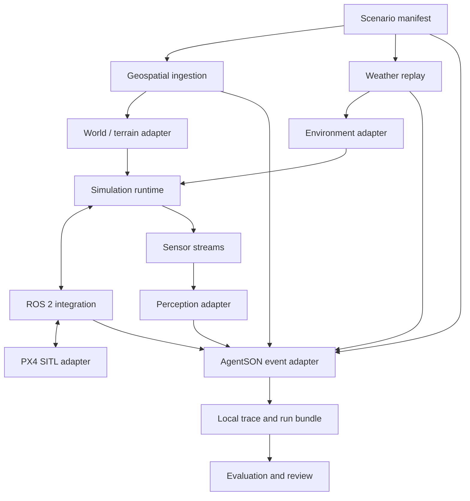

# Architecture

## 1. Architectural intent

The system is a modular research demonstrator. Geospatial data, environmental replay, simulation, robotics middleware, perception, and execution governance are separate concerns connected through documented interfaces.

## 2. Logical view

This diagram describes intended boundaries, not completed integrations.

## 3. Component responsibilities

### Scenario manifest
Defines scenario identity, geographic extent, simulation start/end, data references, configuration versions, seeds, and expected outputs. The manifest should be machine-readable and versioned.

### Geospatial ingestion
Imports terrain and map layers. Every layer carries source, licence, retrieval date, CRS, horizontal/vertical units, resolution, and transformation history. Avoid silently assuming WGS84 or a vertical datum.

### Weather replay
Reads a selected time window from an approved source and normalises units without discarding original values. Each variable includes source status (observed, reanalysis, forecast, derived, or synthetic), timestamp, units, and missingness.

### World and environment adapters
Translate geospatial and environmental inputs into simulator-specific representations. Keep transformations explicit and testable.

### Simulation runtime
Hosts the scene, sensors, and simulated vehicle. Rendering effects must be kept conceptually separate from physical models. A visual flame/smoke asset is not a wildfire spread model.

### Robotics integration
ROS 2 provides message-level integration. PX4 SITL may be used for a simulated autopilot path only after an explicit compatibility test. No real aircraft connection is in MVP scope.

### Perception adapter
Consumes simulated sensor frames and emits structured detections. It records model identity, version, hash, runtime, confidence, timestamp, and coordinate frame. Model output remains a hypothesis, not ground truth.

### AgentSON event adapter
Emits portable execution events describing scenario setup, data provenance, component versions, state transitions, inference metadata, errors, and run completion. AgentSON is an audit/event layer, not a flight controller or safety controller.

## 4. Time and coordinate handling

- Select one canonical simulation clock and document its epoch and time scale.
- Preserve source timestamps and timezone/UTC semantics.
- Record any resampling, interpolation, or clock conversion.
- Use explicit coordinate frames and transform trees.
- Record CRS identifiers and vertical datum where available.
- Test round-trip transforms and known control points.
- Do not merge spatial layers solely because they appear visually aligned.

## 5. Weather data contract

A normalised record should include:

| Field | Meaning |
|---|---|
| `timestamp` | ISO 8601 UTC timestamp or explicitly documented source time |
| `variable` | Canonical variable name |
| `value` | Numeric value or null |
| `unit` | Unit after conversion |
| `source_value` / `source_unit` | Original value and unit where practical |
| `source_id` | Dataset/product identifier |
| `status` | observed, reanalysis, forecast, derived, synthetic |
| `quality_flag` | Source quality or missingness flag |
| `location` | Grid cell or station reference |
| `retrieved_at` | Retrieval timestamp |

Wind direction conventions, vector components, height above ground, grid resolution, and temporal cadence must be explicit. Do not assume a single wind measurement represents the full terrain or canopy environment.

## 6. AgentSON event categories

Suggested semantic event families (map these to the selected AgentSON schema version; names here are conceptual):

- `scenario.created`: manifest and scenario identity.
- `dataset.referenced`: source, licence, retrieval metadata, checksum.
- `component.initialised`: component and version metadata.
- `simulation.started` / `simulation.paused` / `simulation.completed`.
- `environment.sampled`: weather input and provenance.
- `vehicle.state`: simulated vehicle state and coordinate frame.
- `sensor.frame`: frame reference, timestamp, sensor metadata.
- `perception.result`: model metadata and detection result.
- `fault.injected` / `fault.recovered`: resilience test details.
- `run.completed`: outcome, metrics, and bundle references.

Do not claim these exact event names are part of AgentSON until they are mapped to and validated against the actual schema version used by the implementation.

## 7. Offline and degraded-network behaviour

The demonstrator should be able to continue a local simulation without a remote service dependency. Event records should be buffered locally, sequenced, and integrity-checked. On reconnect, preserve original event identity and ordering metadata. Conflicts must be surfaced rather than silently resolved.

## 8. Compatibility gate

Before pinning a stack, record and test:
- operating system and GPU/driver requirements;
- Isaac Sim version and supported ROS 2 distribution;
- ROS 2 middleware and message packages;
- PX4 SITL release and simulator bridge;
- OpenVINO runtime and device plugin;
- Python/C++ toolchain versions;
- asset and dataset licences.

A version combination is supported by this project only after a reproducible smoke test is recorded. Do not infer compatibility from product marketing pages alone.
